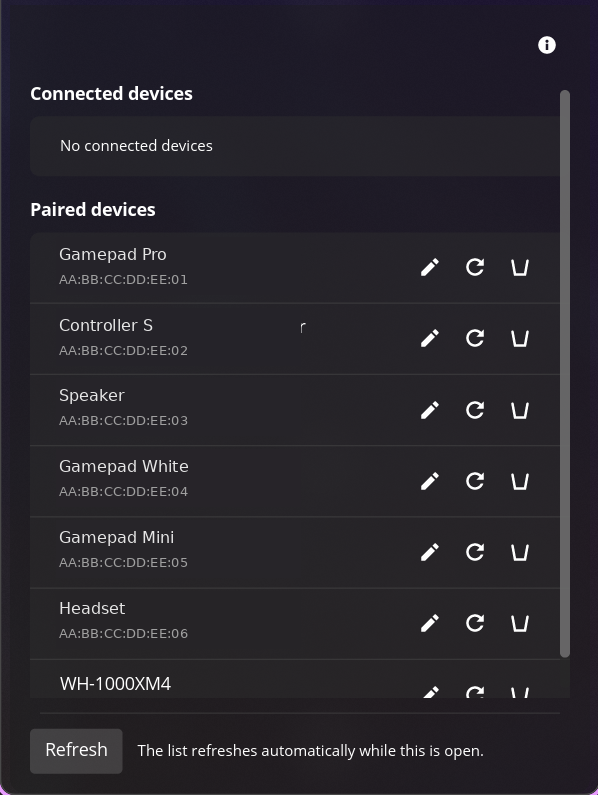

# clippy-pad


COSMIC panel applet for Bluetooth game controllers.

See what is connected, disconnect, rename, remove, and re-pair a controller without leaving the panel. Some controllers (PlayStation DualSense and DualShock in particular) do not reconnect on their own after being used with another device; Clippy Pad re-pairs them by their address.



## Usage

Open **COSMIC Settings → Desktop → Panel → Applets** and add "Clippy Pad" to your panel.
You might need to log out and back in to see the applet in the list of available applets.

Click the panel icon to open the device list. It refreshes every 10 seconds while open; **Refresh** reloads it at once.

- **Connected devices** shows each controller with its address and battery charge (when the kernel reports one), and a **Disconnect** button.
- **Paired devices** lists everything the system remembers, with three actions per row: **Rename**, **Reconnect**, and **Remove**.
- The info button opens About; **Esc** closes the popup or cancels a rename.

## Guides

<details>
<summary>Reconnecting a controller</summary>

**Reconnect** is for a controller that is already paired but will not connect again on its own:

1. Press **Reconnect** on its row. The applet removes the controller from the system's Bluetooth settings and starts a 60 second search; the row shows the countdown.
2. Put the controller in pairing mode (on PS4 and PS5 controllers, hold **Share** and **PS** together until the light bar flashes).
3. Clippy Pad finds it, pairs, trusts, and connects it, and restores its name.

If nothing is found in time, the popup says so. The controller has already been removed from the system's Bluetooth settings by then, so pair it again from **COSMIC Settings → Bluetooth** (or put it in pairing mode and press **Reconnect** again once it shows up in discovery).

</details>

<details>
<summary>Features</summary>

- Connected controllers with battery level, and one-tap disconnect
- Paired controllers: rename, remove, and re-pair by address
- Reconnect countdown shown in the row, with the controller's name kept while the system has already forgotten it
- Buttons stay quiet while a request is running, so a device is never asked twice at once
- Dismissable error card when BlueZ refuses something
- About page with version and license; English strings, ready for translations (Fluent)

</details>

<details>
<summary>Install with just</summary>

Requires BlueZ and the libcosmic build dependencies:

```bash
sudo apt install bluez build-essential cargo cmake just pkgconf libxkbcommon-dev libwayland-dev \
  libssl-dev libexpat1-dev libfontconfig-dev libfreetype-dev
```

```bash
# format check, clippy, and tests
just check

# build the release binary
just build

# install system-wide under /usr (restart the panel to see it)
sudo just install
sudo just uninstall
```

For development, `just run` opens the popup as a regular window (`--standalone`).

If you had the earlier **Cosmic Bluetooth Gamepad** installed under `~/.local`, remove `~/.local/bin/cosmic-bluetooth-gamepad` and `~/.local/share/applications/com.keewee.CosmicBluetoothGamepad.desktop` first: a user-local desktop file overrides the system one.

</details>

<details>
<summary>Run the tests</summary>

```bash
just test
```

</details>

<details>
<summary>Technical notes</summary>

- App ID: `io.github.k33wee.clippy-pad`
- Everything talks to BlueZ over the system bus (`org.bluez`): device lists come from the ObjectManager, actions are `Device1` method calls and properties
- Battery levels are read from `/sys/class/power_supply`, which only some drivers expose (PlayStation controllers do)
- Reconnect = `RemoveDevice`, then discovery by address for up to 60 seconds, then `Pair`, `Trusted`, `Connect`, and the old alias
- Built on [libcosmic](https://github.com/pop-os/libcosmic)

</details>

## Attribution

- "COSMIC" is a desktop environment by System76.
